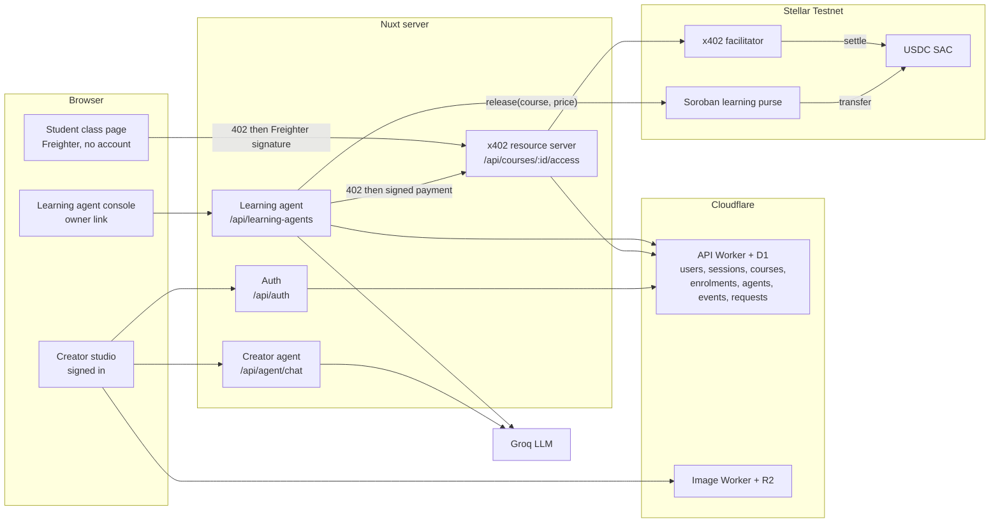
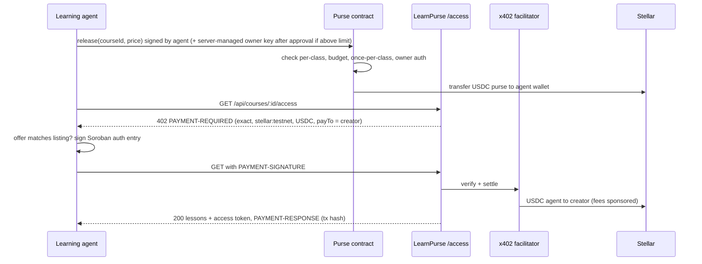

# LearnPurse

**Women turn what they know into paid learning. AI agents find the right class and pay its creator over x402 on Stellar.**

Built for **EmpowerHer: Building the Agent Economy** (Stallion). This prototype uses Stellar
**Testnet USDC**, not real funds.

**Live prototype: [her-wallet.vercel.app](https://her-wallet.vercel.app)**

LearnPurse connects women who teach with people who want to learn. A creator uses AI to publish a
class, private PDF guide or bundle. A learner or sponsor sets a goal and spending rules; a learning
agent finds a matching class, explains its choice and pays the creator through **Stellar x402**.
The budget sits in a **Soroban learning purse**. Its contract enforces spending rules before releasing
one purchase amount to the agent wallet; the agent then signs an x402 payment that settles directly
to the creator's wallet. Buyers can also pay through the same x402 endpoint with Freighter.

| | |
|---|---|
| Network | Stellar Testnet (`stellar:testnet`), Testnet USDC |
| Payments | HTTP 402 + x402 `exact` scheme for Testnet USDC, facilitator settlement with sponsored fees |
| On-chain rules | Soroban learning purse (`contracts/learning-purse`) |
| AI | Groq (`openai/gpt-oss-120b`, falls back to smaller models), keyword fallback when offline |
| Backend | Nuxt 4 server, Cloudflare Workers + D1 (data), Cloudflare R2 (public covers + separate private PDFs) |

---

## The problem

Many women have valuable, practical knowledge: a language, a craft, a trade, how to manage money.
Turning it into income can require a curriculum, sales page, checkout, payment follow-up and access
delivery. That is substantial work before the first learner can buy anything.

On the other side, learners and sponsors want help finding relevant classes without manually
handling every small purchase. Giving an agent unrestricted payment authority is the wrong model:
it needs a way to pay that is **autonomous but bounded**.

## The solution

**For creators.** A woman describes her class in one message ("I teach Yoruba to kids abroad,
6 weeks, 2 USDC, 15 kids"). The creator agent builds a draft and edits its lessons, price,
payment plan and style on request. She approves publication and gets a shareable class page.
On successful x402 settlement, payment goes to **her own Stellar wallet**, and the buyer gets access.

**For learners and sponsors.** An owner creates a learning agent with a goal and spending rules. Then:

1. LearnPurse deploys a **Soroban learning purse** with those rules and moves the budget into it.
2. The AI compares every open class and picks the ones that fit, with a reason for each.
3. For each pick, the agent asks the purse to release **exactly that class price**. The contract checks
   the per-class limit, total budget and whether that class was already paid for. Above the
   ask-first amount, the owner approves in the app and the server adds the owner co-signature.
4. The agent pays the creator over **x402**: the protected class endpoint returns HTTP 402, the agent
   checks and signs the exact offer, the facilitator settles on Stellar, and the class unlocks.
5. The agent logs its decisions and results, with Stellar Expert links for on-chain transactions.

**When no class fits**, the agent does not waste money. It posts a **class request** for creators
(no names or locations), suggests **free resources** while the learner waits, and when a creator
publishes a class for that request, the agent **buys it automatically** inside the same rules.
That closes the loop: learner demand turns into new income for women creators.

## Why Stellar x402 is central

LearnPurse does not merely show a wallet address next to a checkout button. Each paid class or guide
is a protected HTTP resource at `GET /api/courses/:id/access`. Without payment, the endpoint responds
with **HTTP 402** and a `PAYMENT-REQUIRED` header specifying the `exact` scheme, `stellar:testnet`,
the Testnet USDC amount and the creator's address as `payTo`.

An agent first obtains one class price from the Soroban purse. It compares the x402 offer with the
published price, recipient and network, then retries the request with a signed `PAYMENT-SIGNATURE`.
The resource server uses the x402 facilitator to verify and settle the payment. On success, it
returns paid access and a `PAYMENT-RESPONSE` with settlement evidence. This lets a learning agent
complete a purchase using a standard payment challenge, while a human buyer can use Freighter
through the same endpoint. The creator receives Testnet USDC directly rather than waiting for a
LearnPurse payout. The purse release and the x402 payment are separate Stellar transactions.

## Demo flow (2 to 3 minutes)

1. **Learner side**: open `/agent`, pick the example "Ada wants to speak Yoruba with her grandma",
   set the rules (5 USDC per class, 6 total, ask me above 3) and **Create agent**. The log shows the
   purse contract being deployed and funded.
2. **Let the agent shop**: it pays for the 2 USDC Yoruba class by itself (purse release + x402
   payment, two transactions on Stellar Expert) and asks for approval on the 4 USDC crafts class.
3. **Approve and pay**: the owner approves in the app; the server co-signs the purse release, the class
   is paid and appears in the library.
4. **No match**: change the goal to "piano lessons". The agent posts a class request and suggests free
   resources.
5. **Creator side**: sign in at `/login`, see "Learners are asking for" in the studio, click
   **Build this class**, the creator agent writes it, say "publish it". The learner's agent buys it on its own.

## Private paid PDF guides and bundles

Creators can choose **Class**, **PDF document**, or **Class + PDF bundle** in the studio’s Review step.
For PDF products, upload a PDF up to 20 MiB before publishing. A creator-authenticated upload receipt
binds the file metadata to that account, so another creator cannot attach someone else’s upload.
Buyers use the same existing x402 payment flow. Once settlement grants a paid access token, the
product page offers **Download PDF**. Downloads require that exact product’s bearer token and stream
through Nuxt as private, non-cacheable attachments. Public listings reveal only the filename and size.

PDF bytes live in the dedicated `DOCUMENTS` R2 binding (`learnpurse-private-documents`), not the public
cover bucket. Keep r2.dev access disabled and do not add a public custom domain to this bucket.
The storage Worker authenticates PDF reads and writes with the server-only upload secret. Apply D1
migration `0007_documents.sql` with the rest of the migration chain. Full API contracts and rollout
requirements are in [`docs/private-documents.md`](docs/private-documents.md).

Run the real acceptance workflow against a configured Nuxt server:

```sh
node --env-file-if-exists=.env scripts/document-e2e.mjs http://localhost:3000
```

This creates throwaway Testnet accounts and creator listings, obtains Testnet USDC, pays exactly
**1 Testnet USDC** through x402, verifies the creator’s balance, and compares the downloaded bytes
with the uploaded PDF. It also checks anonymous/forged/cross-product token denial, upload ownership,
metadata tampering, and direct Worker privacy when `NUXT_IMAGE_UPLOAD_URL` is set. It never uses
mainnet or an existing wallet’s secret key. Test fixtures remain private and can be cleaned up later.

## How the money is protected

Three independent layers. The AI controls none of them.

| Layer | Where | What it enforces |
|---|---|---|
| 1. Learning purse | Soroban contract on Stellar | per-class limit, total budget, each class paid once, server-managed owner co-signature after in-app approval above the ask-first amount, pause, withdraw |
| 2. x402 client | agent runtime | signs only an offer that matches the listed price, creator wallet and Testnet. Library spend cap set to the per-class limit |
| 3. Agent wallet | Stellar account | receives one class price per approved release instead of holding the whole budget |

The model selects the class; the contract enforces the release rules. The server stores encrypted
signing keys for the demo, including the key used to co-sign owner-approved releases. The agent
wallet receives one authorized class price at a time rather than the entire purse balance.

The same rules are also checked in code before any on-chain call (`shared/agent-policy.ts`, unit
tested), so the agent explains a refusal in plain words instead of just failing a transaction.

## Architecture



### x402 payment flow (agent)



Students who are not using an agent follow the same x402 flow from the class page, signing with
Freighter. They need **no account**, only a wallet.

## What is implemented

**Creator side**
- Creator accounts: sign up, sign in, sign out. Sessions are httpOnly cookies stored as hashes in D1,
  passwords use scrypt.
- **Publishing and the earnings dashboard require a signed-in creator.** The payout wallet and the
  creator name always come from the account, never from the request, so nobody can publish a class
  that pays someone else.
- Creator agent (chat): builds the class from one message, then edits it step by step. It can set
  details, write, add, move and remove lessons, set pricing (one payment, repeat or installments) and
  style. It shows each change it made and asks before publishing. It checks its own result and retries once.
- "Make it yours": cover upload (R2), accent colour, tagline.
- "Learners are asking for": open class requests from learning agents, built with one click.

**Learner side**
- Learning agents with dedicated Testnet signing wallets and a Soroban purse holding the budget.
  LearnPurse creates and funds the demo wallet; it does not import a personal wallet secret.
- AI class selection with reasons, keyword fallback, one level per subject.
- Owner approval above a threshold, decline, editable rules (written to the contract too).
- Class requests when nothing fits, free resources (curated list, optional Apify web search).
- Library of bought classes that open already unlocked.

**Student (no agent)**
- Public class page with an AI assistant answering only from the published class.
- Pay with Freighter over x402, single payment, repeat or installments. Seat limits are checked
  atomically in D1, and a transaction hash can't be recorded twice.
- Optional signed-in student account (sign up/in at `/signup` and `/login`): the class page shows
  a "My classes" link to `/library`, where the student sees the classes their account has access to
  and their payment history (recorded in `enrolments.user_id`).

Account-based access needs the D1 migration `0008_student_library.sql` applied; enrolments made
without an account still work via the wallet token.

## Verified on Stellar Testnet

These run against real Testnet and print Stellar Expert links:

| Script | What it proves |
|---|---|
| `npm run test:purse` | Deploys the purse and checks on-chain: release within limits succeeds; over per-class limit, same class twice, above ask-first without owner, and over budget are all refused; owner-signed release succeeds |
| `npm run test:agent` | Agent with a purse buys a class by itself, asks for approval on a pricier one, pays after approval, never rebuys |
| `npm run test:requests` | No match, so the agent posts a request. A creator publishes for it, and the agent buys it by itself |
| `npm run test:auth` | Publishing and dashboard need a session; payTo comes from the account; creators only see their own classes; logout and bad passwords |
| `node scripts/x402-testnet-e2e.mjs` | Student-style x402 payment, creator receives exactly the price |

Contract unit tests: `npm run contract:test` (6 tests for the purse, plus the course registry).
App unit tests: `npm test` (53 tests: pricing, drafts, agent rules, free resources, studio flow and more).

## Run it locally

Requirements: Node 24, npm, Rust with the `wasm32v1-none` target (only for the contract).

```sh
npm ci
cp .env.example .env        # then fill in the values below
npm run contract:build      # builds contracts/target/wasm32v1-none/release/*.wasm
npm run dev                 # http://localhost:3000
```

Environment (all server-only):

| Variable | Purpose |
|---|---|
| `NUXT_AI_PROVIDER`, `NUXT_AI_API_KEY` | `groq` (or `gemini`) and its key. Without a key, rule-based fallbacks are used |
| `NUXT_CLOUD_API_URL`, `NUXT_CLOUD_API_SECRET` | the D1 API Worker (`cloudflare/api-worker`) |
| `NUXT_IMAGE_UPLOAD_URL`, `NUXT_IMAGE_UPLOAD_SECRET` | the R2 image Worker (`cloudflare/image-worker`) |
| `NUXT_AGENT_WALLET_KEY` | 32+ character key that encrypts agent and purse-owner secrets at rest (AES-256-GCM) |
| `NUXT_X402_FACILITATOR_URL` | defaults to `https://www.x402.org/facilitator` |
| `NUXT_APIFY_TOKEN` | optional, adds live web results to free resources |

Cloudflare backend:

```sh
cd cloudflare/api-worker
npx wrangler d1 migrations apply coursepay-db --remote
npx wrangler secret put API_SECRET
npx wrangler deploy
```

Demo data: `npm run seed:demo` and `npm run seed:common` publish sample classes from throwaway creator
accounts with fresh Testnet wallets.

## Project layout

```
app/components/        LandingView, SignupView, LoginView, StudioView, AgentComposer,
                       ClassView (student), LearningAgentView (agent console)
server/api/            auth, courses (x402 access), agent (creator AI), learning-agents, requests, uploads
server/utils/          ai, auth, cloud (D1 client), courses, x402, learning-agent, purse (Soroban), free-resources
shared/                course validation, agent planner, agent-policy (rules), free-resources
contracts/learning-purse   Soroban purse: release, set_limits, set_paused, withdraw, state
contracts/course-registry   earlier on-chain course registry (not used by the agent flow)
cloudflare/api-worker  D1 API (migrations/0001-0004)
cloudflare/image-worker  R2 cover images
scripts/               Testnet end-to-end checks and seed scripts
```

## Team and credits

Built for EmpowerHer: Building the Agent Economy, a women-focused hackathon by Stallion with the
Stellar ecosystem. Photography credits: [docs/photography.md](docs/photography.md).
# TeamHerWallet
